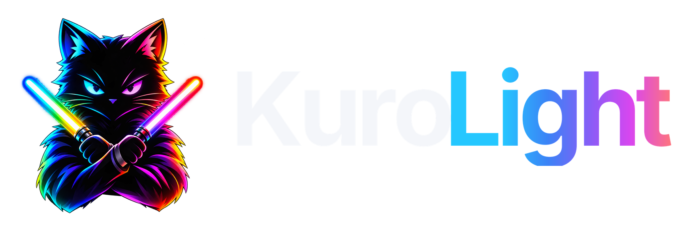

<div align="center">



### Intelligent Visual Creation & Non-Destructive Photographic Studio

A modern, high-performance photo library and raw development workstation.<br/>
Original master files remain pristine while adjustments are rendered in real time through an accelerated 32-bit floating-point processing graph.

[](pyproject.toml)
[](pyproject.toml)
[](web/package.json)
[](web/package.json)
[](src/kurolight/processing/enhancement.py)
[](tests/)
[](pyproject.toml)

<p align="center">
  <a href="#-quickstart">Quickstart</a> •
  <a href="#-why-kurolight">Why KuroLight?</a> •
  <a href="#-workspaces">Workspaces</a> •
  <a href="#-color-fidelity--icc-profiles">Color Science</a> •
  <a href="#-presets-catalog">54 Presets</a> •
  <a href="#-architecture">Architecture</a> •
  <a href="#-keyboard-shortcuts">Shortcuts</a> •
  <a href="#-documentation-hub">Docs</a>
</p>

</div>

---

## 📸 Overview

**KuroLight** is a desktop photo management and editing environment engineered from first principles around one sacred rule: **your source photographs are never modified**.

Every edit—from basic exposure and white balance to complex 3-way color grading wheels, parametric tone curves, 3D LUT evaluation, local brush masks, spot healing, and neural super-resolution—is recorded as an immutable, versioned adjustment state. Adjustments are dynamically applied through a 32-bit floating-point Python computational DAG graph, visualized through an ultra-responsive React 19 interface, and materialized only when exported via the background batch delivery queue.

---

## ✨ Why KuroLight?

```
┌─────────────────────────────────────────────────────────────────────────────┐
│                            KUROLIGHT ADVANTAGES                             │
├───────────────────────┬─────────────────────────────┬───────────────────────┤
│ 🛡️ Non-Destructive    │ ⚡ 32-bit Float Pipeline    │ 🧠 Kuro AI Assistant  │
│ Master files remain   │ Precision NumPy & Pillow    │ Vision LLM-powered    │
│ untouched. Adjustments│ processing graph; zero UI   │ photographic critique │
│ serialize to atomic   │ thread rendering blocking.  │ & candidate recipes;  │
│ SQLite edit states.   │                             │ approval-gated.       │
├───────────────────────┼─────────────────────────────┼───────────────────────┤
│ 🎯 Cross-Device Color │ 🎨 54 Built-in Presets      │ 📦 Deliver Queue      │
│ Embedded sRGB ICC     │ Film emulation, portraits,  │ Multi-format batch    │
│ profiles guarantee    │ cinematic grades, landscape │ exporting with token  │
│ exact mobile/WhatsApp │ & monochrome recipes with   │ templates, watermarks,│
│ color consistency.    │ instant search & filtering. │ and pause/resume.     │
└───────────────────────┴─────────────────────────────┴───────────────────────┘
```

- **Zero Data Loss Guarantee**: All edits, snapshots, ratings, flags, and undo histories survive app restarts and are preserved even in Recently Deleted trash.
- **Privacy-First Design**: Photos stay local on your machine. Cloud AI connections are strictly opt-in and gated by explicit disclosure; credentials live solely in your operating system's secure keychain.
- **Cross-Platform Ready**: Architected with strict path normalization, directory traversal defense, and hardware execution provider abstraction across Windows, macOS, and Linux.

---

## 🎨 Color Fidelity & Cross-Device Display

KuroLight solves the common issue of exported photos shifting colors when shared on WhatsApp, mobile devices, or external browsers:
* **Canonical sRGB ICC Embedding**: All JPEG, PNG, TIFF, and WebP exports automatically embed the standardized sRGB color profile via `PIL.ImageCms`.
* **Zero Color Shifting**: Ensures mobile operating systems and messaging apps correctly interpret tonal balance without washing out skin tones or over-saturating highlights.
* **3D LUT Engine**: Dynamic mathematical evaluation and trilinear interpolation supporting standard `.cube` Look-Up Tables.

---

## 🎞️ 54 Built-in Presets Catalog

KuroLight includes **54 curated style recipes** categorized for instant darkroom workflows:
- **Film Emulation (13)**: Kodak Portra 400, Fuji Pro 400H, Ilford HP5 Plus, Kodachrome 64, CineStill 800T, Fuji Velvia 50, Agfa Vista 200, Kodak Tri-X 400, Classic Chrome, Polaroid SX-70, and more.
- **Portrait & Studio (8)**: Warm Editorial, Studio Soft, Golden Hour Glow, High Key Beauty, Moody Dramatic, Porcelain Skin, Earthy Bohemian, Cinematic Portrait.
- **Cinematic & Color Grade (9)**: Teal & Orange, Film Bleach Bypass, Cyberpunk Neon, Vintage Warmth, Moody Nordic, Technicolor 2-Strip, Matte Film, Anamorphic Dusk, Golden Blockbuster.
- **Landscape & Nature (8)**: Vivid Landscape, Golden Sunset, Dramatic Forest, Desert Warmth, Arctic Glacier, Deep Ocean, Autumn Equinox, Misty Mountain.
- **Urban & Street (4)**: Tokyo Night, Street Classic, Muted Concrete, Neon Alley.
- **Monochrome & Fine Art (7)**: B&W High Contrast, Fine Art Monochrome, Silver Gelatin, Sepia Warmth, Noir Dramatic, Low Key Dark, Infrared B&W.
- **Creative & Lifestyle (5)**: Retro Pop, Pastel Dream, Warm Hearth, Soft Glow, Clean Minimalist.

*All presets feature non-destructive merging, live category pills, instant search filtering, and custom user preset saving.*

---

## 🖥️ Workspaces

KuroLight provides five dedicated, task-focused workspaces accessible via the top navigation bar or `Alt+1` through `Alt+5`:

### 1. 🖼️ Gallery (`Alt+1`)
*The photographic library, organization, and culling hub.*
- **Virtualized Grid & Table Views**: Smoothly handles thousands of assets with lazy thumbnail decoding.
- **Folder & Album Navigation**: Filter catalog by filesystem directory representation or custom nested collections.
- **Smart Collections**: Dynamically aggregate assets matching text search queries, star ratings (0–5), pick/reject flags, and source folders.
- **Compare & Survey**: Inspect 2 loaded images side-by-side or survey 2–4 candidates simultaneously with shared zoom and per-photo culling hotkeys.
- **Metadata Inspector**: View EXIF capture data (camera, lens, shutter, aperture, ISO) and edit catalog metadata (title, caption, keywords, copyright).
- **Indefinite Recoverable Trash**: Soft-delete catalog records without touching original files on disk; restore anytime or confirm permanent removal.

### 2. 💡 Lightbox (`Alt+2`)
*The primary photographic development and adjustment darkroom.*
- **Global Tone & Exposure**: Exposure ($\pm 5\text{ EV}$), Contrast, Highlights, Shadows, Whites, and Blacks.
- **White Balance & Color**: Color Temperature, Tint, Vibrance, and Saturation.
- **Detail & Texture**: Unsharp masking, bilateral noise reduction, texture, high-pass clarity, and atmospheric dehaze.
- **Optics & Geometry**: Manual lens radial distortion correction, optical vignetting, transverse chromatic aberration, straighten, crop aspect constraints, and flips.
- **Local Adjustment Masks**: Paintable brush masks, linear gradients, radial gradients, luminance ranges, and color ranges combined via replace, add, subtract, or intersect operations.
- **Spot Retouching**: Non-destructive healing and cloning with draggable source/target pins on canvas.
- **Presets & History**: Searchable 54 built-in presets, custom recipes, snapshot checkpoints, and per-asset undo/redo timeline scrubbing.

### 3. 🌈 Color Studio (`Alt+3`)
*Precision color grading and broadcast-grade scopes.*
- **3-Way Color Wheels**: Independent Lift (shadows), Gamma (midtones), Gain (highlights), and Offset controls with hue wheels and luminance sliders.
- **Parametric Curves**: Master RGB curve plus independent Red, Green, and Blue tonal splines with curve anchor points.
- **HSL Channel Mixer**: 8 distinct color bands with dedicated Hue, Saturation, and Luminance offsets.
- **Real-Time Video Scopes**: Live preview-derived RGB Histogram, Waveform monitor, and Vectorscope for objective monitoring.

### 4. 🔀 Visual Flow (`Alt+4`)
*Node-based pipeline visualization and non-destructive graph inspection.*
- **Node-Based Processing Graph**: Inspect each discrete step in the image processing chain (Decode → Source Buffer → Geometry → Denoise → Tone → Optics → Color Grading → Output).
- **Toggle Node Passes**: Enable or bypass individual processing stages to audit their exact contribution to the final render.

### 5. 📦 Deliver (`Alt+5`)
*Batch export queue, watermarking, and production publishing.*
- **Multi-Format Encoders**: Export to JPEG, PNG, WebP, TIFF, BMP, GIF, and PPM with custom quality compression and embedded sRGB ICC color profiles.
- **Dynamic Naming Tokens**: Format filenames using `{name}`, `{date}`, `{camera}`, `{lens}`, `{iso}`, `{shutter}`, `{focal_length}`, and sequence counters.
- **Watermark Engine**: Apply text stamps or PNG graphic logos with adjustable opacity, scale, margin offsets, and 9 anchor positions.
- **Resilient Background Queue**: Queue multi-image jobs with real-time progress indicators; pause safely between photos, resume, or cancel without hanging.
- **Collision Protection**: Automatically refuses output collisions to prevent accidental source file overwrites.

---

## 🎨 Dynamic Personalization & Theming

KuroLight features a dynamic design system powered by CSS custom properties (`--obsidian-accent`):
* **Live Studio Swatches**: Instantly toggle between Sapphire Blue, Emerald Green, Amber Gold, Crimson Red, Amethyst Purple, and Silver.
* **Custom Hex Picker**: Choose any custom brand color in **Settings (`Ctrl+,`) → Appearance**; changes apply immediately without reloading.
* **Unified Iconography**: Native high-resolution logo and multi-size favicons embedded across window titlebars, splash screen, and browser views.

---

## 🧠 Kuro AI & Local Models

KuroLight blends cloud-based generative intelligence with 100% private, on-device neural processing:

```mermaid
flowchart TD
    subgraph Cloud["Kuro AI (Cloud Vision Assistant)"]
        A1[User Prompt + Photo Preview] --> A2{Consent Accepted?}
        A2 -- No --> A3[Block Request]
        A2 -- Yes --> A4[Provider: Gemini / OpenAI / Claude]
        A4 --> A5[Structured Candidate Proposal]
        A5 --> A6[Side-by-Side Review]
        A6 --> A7{Fingerprint Matches?}
        A7 -- Changed in Flight --> A8[Safely Reject Stale Edit]
        A7 -- Valid --> A9[Approve & Apply Non-Destructively]
    end

    subgraph Local["Local AI Enhancement (On-Device)"]
        B1[Real-ESRGAN x4 ONNX] --> B2[Explicit Download with SHA-256 Check]
        B2 --> B3[DirectML / CUDA GPU Acceleration]
        B3 --> B4{GPU Available?}
        B4 -- Error / No GPU --> B5[Automatic CPU Fallback]
        B4 -- Yes --> B6[Accelerated Tile Inference]
        B5 --> B7[Visually Lossless Output PSNR >= 42 dB]
        B6 --> B7
    end
```



### 1. Kuro AI Assistant (Cloud Vision)
- **Supported Providers**: Google Gemini (Gemini 2.5 Flash), OpenAI (GPT-4o / GPT-4o mini), and Anthropic (Claude 3.7 Sonnet).
- **OS Keychain Security**: API keys are saved exclusively in the operating system credential store (Windows Credential Locker, macOS Keychain, Linux Secret Service).
- **Strict User Approval**: Kuro AI cannot apply edits directly. Every proposal must be approved after side-by-side visual review.

### 2. Local AI Super-Resolution (Real-ESRGAN x4)
- **100% On-Device & Offline**: Neural super-resolution runs entirely on your local hardware with zero network calls and zero telemetry.
- **Verified Download Integrity**: Verified against SHA-256 hash `fa18ce70de3a55f3149d0cc898d335d2d69fca29edc0692cb362c856b2942c3f`.
- **Hardware Acceleration with CPU Fallback**: Utilizes DirectML (DirectX 12) or CUDA when compatible hardware is present, with seamless fallback to CPU execution.

---

## 📐 Architecture & Technology Stack

```
┌────────────────────────────────────────────────────────────────────────┐
│                        DESKTOP SHELL (PySide6)                         │
├────────────────────────────────────────────────────────────────────────┤
│                       WEBVIEW UI (React 19 + TS)                       │
│  Gallery  │  Lightbox  │  Color Studio  │  Visual Flow  │  Deliver     │
├────────────────────────────────────────────────────────────────────────┤
│                     TYPED IPC BRIDGE (pywebview)                       │
│  Command Dispatcher  │  Event Streaming  │  Keyring Credential Manager │
├────────────────────────────────────────────────────────────────────────┤
│                     PYTHON COMPUTATIONAL CORE                          │
│  • SQLite Catalog Persistence & Migrations (WAL Mode)                  │
│  • LRU Working Buffer & Thumbnail Cache                                │
│  • 32-bit Float NumPy / Pillow Image Processing DAG Graph              │
│  • ONNX Runtime DirectML / CUDA Inference Engine                       │
│  • Background ThreadPool Batch Export Manager                          │
└────────────────────────────────────────────────────────────────────────┘
```

---

## ⌨️ Keyboard Shortcuts

All application hotkeys require modifier keys (`Ctrl`, `Shift`, or `Alt`) to prevent accidental photo edits while typing:

### Workspace Navigation
| Shortcut | Action |
|---|---|
| `Alt+1` | Open **Gallery** Workspace |
| `Alt+2` | Open **Lightbox** Workspace |
| `Alt+3` | Open **Color Studio** Workspace |
| `Alt+4` | Open **Visual Flow** Workspace |
| `Alt+5` | Open **Deliver** Workspace |
| `Ctrl+,` | Open **Settings** Modal |

### Library & Culling (Gallery)
| Shortcut | Action |
|---|---|
| `Ctrl+O` | Import images from disk |
| `Ctrl+Enter` | Open selected image in Lightbox |
| `Ctrl+A` | Select all visible images in grid |
| `Ctrl+Alt+1` … `Ctrl+Alt+5` | Set Star Rating (1 to 5 stars) |
| `Ctrl+Alt+0` | Clear Star Rating |
| `Ctrl+Alt+P` | Flag image as **Pick** |
| `Ctrl+Alt+U` | Set image as **Unflagged** |
| `Ctrl+Alt+X` | Flag image as **Reject** |
| `Ctrl+Shift+Backspace` | Move image to Recently Deleted Trash |

### Development & Viewport (Lightbox)
| Shortcut | Action |
|---|---|
| `Ctrl+S` | Save current edit adjustments |
| `Ctrl+Z` | Undo last adjustment |
| `Ctrl+Shift+Z` / `Ctrl+Y` | Redo adjustment |
| `Ctrl+K` | Toggle **Kuro AI** Assistant Panel |
| `Ctrl+Shift+C` | Toggle Crop Tool |
| `Ctrl+Shift+F` | Toggle Filmstrip |
| `Ctrl+Shift+P` | Toggle Right Adjustments Panel |
| `Ctrl+Shift+Escape` | Close active dialog or dismiss crop mode |

---

## 🚀 Quickstart

### Prerequisites
- **Python**: Version 3.10 or higher
- **Node.js**: Version 18 or higher (with npm)
- **Operating System**: Windows 10/11 (with Microsoft Edge WebView2), macOS 12+, or Linux (Ubuntu 22.04+, Fedora 38+)

### 1. Set Up Python Environment
```bash
# Clone the repository
git clone https://github.com/kuroLabs-ai/KuroLight.git
cd KuroLight

# Create and activate virtual environment
python -m venv .venv

# Windows
.venv\Scripts\activate

# macOS / Linux
source .venv/bin/activate

# Install requirements
pip install -r requirements.txt
pip install -r requirements/testing.txt
pip install -e .
```

### 2. Build Frontend Assets
```bash
# Install npm dependencies and build production bundle
npm --prefix web install
npm --prefix web run build
```

### 3. Launch KuroLight
```bash
# Launch desktop application
python -m kurolight.run_gui

# Or via console entrypoint script
kurolight-gui
```

### 4. Development Mode (with Live Hot Reload)
```bash
# Terminal 1: Run Vite dev server
npm --prefix web run dev

# Terminal 2: Launch KuroLight in dev mode
python -m kurolight.run_gui --dev
```

---

## 🧪 Testing & Quality Assurance

KuroLight maintains an automated testing suite with **100% test pass status**:

```bash
# Run all 308 unit and integration tests
pytest

# Run tests with short progress summary
pytest -q
```

---

## 📚 Documentation Hub

Explore in-depth technical guides and specifications in the [`docs/`](docs/) directory:

| Document | Description |
|---|---|
| [**Architecture & Lifecycle**](docs/ARCHITECTURE_AND_LIFECYCLE.md) | Startup sequence, splash screen, Qt lifecycle, and PyBridge IPC. |
| [**Services & Methods Reference**](docs/SERVICES_AND_METHODS.md) | Exhaustive API specification for all backend services and bridge endpoints. |
| [**Image Processing Pipeline**](docs/IMAGE_PROCESSING_PIPELINE.md) | 32-bit float buffer, DAG node execution, color science, and sRGB ICC profiles. |
| [**Presets Reference Catalog**](docs/PRESETS_REFERENCE.md) | Complete guide to all 54 built-in photographic style presets and parameter schemas. |
| [**Kuro AI Assistant**](docs/AI_SYSTEM.md) | Dual-engine architecture, tool declarations, and human-in-the-loop review workflow. |
| [**Frontend & Workspaces**](docs/FRONTEND_AND_WORKSPACES.md) | UI components, dynamic accent theming, composition overlays, and shortcuts. |
| [**Developer & CLI Guide**](docs/DEVELOPER_AND_CLI_GUIDE.md) | Installation, CLI commands, SQLite WAL database architecture, and building. |
| [**Core Architecture Guide**](docs/KUROLIGHT_ARCHITECTURE_GUIDE.md) | Foundational architectural blueprint and engineering patterns. |
| [**Engineering Playbook**](docs/ENGINEERING_PLAYBOOK.md) | Development workflows, coding conventions, and verification standards. |
| [**Feature Parity Tracker**](docs/FEATURE_PARITY.md) | Roadmap capability map and implementation status matrix. |

---

<div align="center">

**KuroLight** — Built for thoughtful, deliberate photographic workflows.<br/>
Crafted by KuroLabs.

</div>
